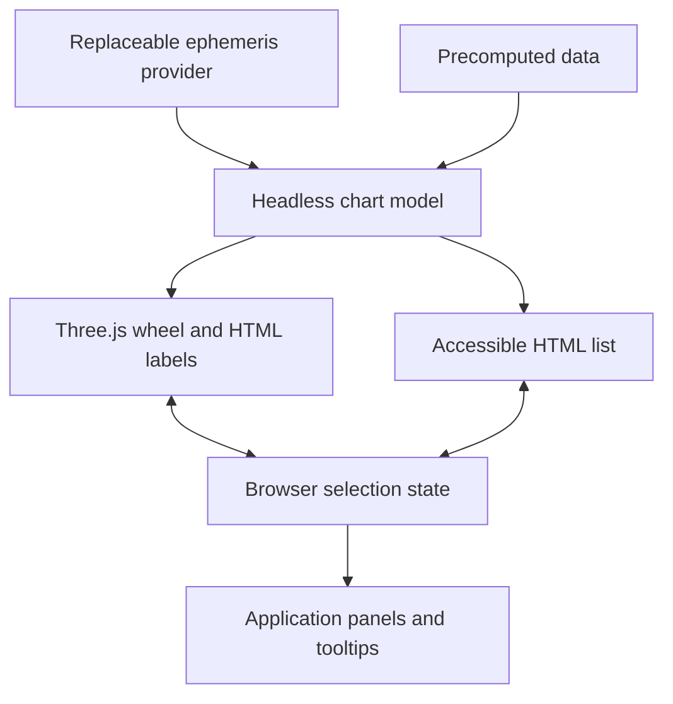

# Architecture and integration

The model owns positions, actual cusps, signs/houses/aspects, IDs, and relationships. Rendering owns projection, glyph placement, picking, and display state. Moving a glyph never changes its longitude. Providers own calculation; selection and navigation never invoke them.

## Boundaries

- `astr3/model`: pure data/types/math, usable in Node/workers without Three.js.
- `astr3`: renderer and model exports. No document access at import; instantiate on the client.
- `astr3/ephemeris`: optional Astronomy Engine peer. No DOM/Three.js, and no network needed after assets load.
- Demo: birth form, request orchestration, interpretation text, details, tooltip, and examples are application code.

The orthographic renderer schedules frames on demand. Stroke geometry keeps widths/dashes in CSS pixels instead of relying on platform-dependent WebGL line widths. Projected HTML labels avoid CSS2DRenderer's browser-zoom assumptions. Labels and invisible targets use the same layout.

Chart-weight presets scale the shared stroke geometry and label typography together. Body-label measurements include glyph stroke and font weight, and the placement solver reserves the measured house-number bounds. Changing weight reruns this layout without changing astronomical positions or selection IDs.

Picking compares shapes in CSS pixels. One semantic selection drives highlighting, keyboard state, announcements, and application events. Accessible buttons are built from the model and survive unavailable/lost graphics.

## Application lifecycle

Create after the host mounts. Subscribe to selection/hover for UI, use `update` for data and `setOptions` for display. Stable IDs preserve selection. Unsubscribe and dispose at unmount. Only the chart's own root is removed.

For a remote/worker provider: cancel the prior request, increment a revision, request data, and apply only the current result. Display failures separately while retaining the previous valid chart. Provider, invalid-data, and graphics failures are distinct. The library has no accounts, service, or storage.

## Development and release

`npm run check` verifies types, unit/reference behavior, and library/demo builds. `npm run test:browser` exercises actual Chromium WebGL and mobile touch emulation. Ignored `test-results/` contains review screenshots and failure traces. Run `npm run format:check` before committing.

`npm pack` includes ESM, declarations, JavaScript maps with inline sources, docs, license, and notices. Dependencies stay external to the library build. The demo lazy-loads the ephemeris. Physical devices, Firefox, and Safari need further verification before claiming equivalent support.

Transit bi-wheels use a separate composite model with source-qualified identities and independent natal, cross-chart, and transit aspect families. The transit adapter projects that model into the shared renderer using internal scoped IDs; the public API retains callers' original IDs. Both modes share projection, DOM/GPU lifecycle, accessibility, picking, and interaction logic. Transit labels pin outward from the zodiac without a separate rim, and all sources project to the same house-circle anchors. A presentation describes source bands and family visibility. The bounded label solver accepts a band geometry while retaining the original natal defaults.

`calculateTransits` reuses the provider's planetary-position calculation without house calculations or location inputs. The demo owns transit UTC stepping and cancellation, and orb changes only rebuild the model. [Transit API](transits.md) documents identities, house semantics, and lifecycle. Synastry and cross-chart pattern groups remain future work.
