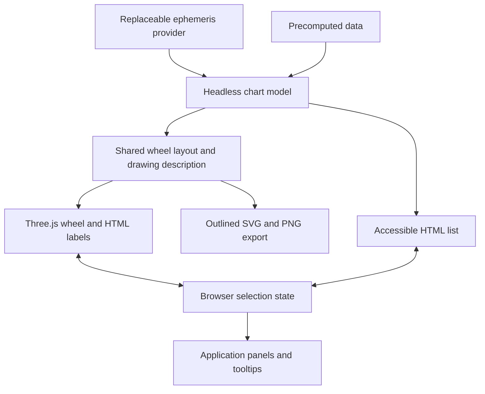

# Architecture and integration

This guide explains how ASTR3 separates data, calculation, rendering, and
application UI. For usage and supported options, see the [API reference](api.md)
and [integration walkthrough](agent-integration.md).

The model owns positions, actual cusps, signs/houses/aspects, IDs, and
relationships. Rendering owns projection, label placement, picking, and display
state. Moving a glyph never changes its longitude. Providers own calculation;
selection and navigation never invoke them.

## Boundaries

- `@yuzuwoeser/astr3/model`: pure data, types, and math for Node, workers, or browsers without
  Three.js or ephemeris imports.
- `@yuzuwoeser/astr3`: renderer, model exports, and optional transit animation controller.
  Import is SSR-safe; create charts after their browser hosts mount.
- `@yuzuwoeser/astr3/ephemeris`: optional Astronomy Engine adapter. No DOM, Three.js, or remote
  calculation service.
- Demo: forms, request orchestration, interpretation text, details, tooltips, and
  time controls belong to the application.

## Shared drawing and export

The wheel drawing builder produces ordered shapes, positioned labels, cluster
badges, and hit targets without DOM or GPU access. Interactive and export
backends share geometry and the bounded packing solver, with injected text
measurement: a cached DOM probe for interaction, outline metrics for export.

The orthographic renderer schedules frames on demand. Stroke geometry keeps
widths/dashes in CSS pixels rather than relying on platform WebGL line widths.
Triangles batch into one geometry with per-vertex RGBA and a reusable unlit
material, retaining paint order without repeated shader compilation. Projected
HTML labels and invisible targets use the same layout. Resize observation
requests a frame; stage-size writes happen during drawing, outside observer
delivery.

Exports snapshot model/display state before asynchronously importing the SVG
writer and font data. Full exports fit their own viewport; current-view exports
preserve camera/aspect ratio and scale the resulting drawing. Visible text uses
licensed Noto outlines. SVG is self-contained; PNG uses a temporary SVG object
URL and 2D canvas, released on success or failure. Export never reads the WebGL
framebuffer. [Export contracts](api.md#svg-and-png-export) cover font support,
colors, size limits, and failures.

## Layout geometry and visibility

The wheel-geometry resolver supplies the selected `default`, `alternative`, or `advanced`
preset to camera fitting, rulers, house sectors, label bands, anchors, and
picking. Default natal houses sit inside the zodiac; transit labels pin outward
from its outer edge without a separate rim. Alternative houses form an outer
annulus, with zodiac second and both source symbol bands inside; the aspect
circle is independent of houses. Alternative house picking uses an annular
polygon rather than a sector extending to the center. Layout never enters the
headless model or provider request. Advanced keeps the zodiac outermost, with
house spokes across its planet bands, house numbers immediately outside a small
central aspect disk, and annular house picking that excludes that disk. Its
upright planet captions include zodiac sign glyphs, and measured outer cusp
captions yield to axis captions and earlier house numbers when they collide.
The shared drawing pipeline applies these choices to HTML labels and SVG/PNG
exports. Advanced keeps body position captions at every effective scale, with a
9px minimum. It shrinks glyphs or clusters bodies without dropping their
captions, even when the degree scale is hidden. It draws no body leaders or
active radial guides; exact dots and aspect anchors remain selectable.

Each source's exact longitude markers and central aspect anchors remain fixed
when labels move. Default transit labels prefer a band close to the zodiac,
omitting captions before using the wider available band. Alternative sources
use equal-width symbol bands and separate inner-facing rulers. Active bodies
and aspect/group members in the alternative layout gain faint dashed guides to their inner anchors;
these guides add no picking targets.

Per-body visibility excludes hidden bodies from packing, exact markers,
connected aspect/group graphics, and wheel picking. The model, original input,
relationships, house occupancy, selection, and accessible entries remain intact.
Transit visibility maps use original IDs separately for each source; only the
shared renderer receives scoped IDs. Visibility does not affect calculation or
animation sampling.

## Label placement and typography

The circular packing solver uses bounded separation constraints and least-squares
isotonic regression. It evaluates one/two-row arrangements, minimizes worst
angular displacement before squared movement, and caps displacement at 30°.
Conservative bounding discs keep measured rectangles clear of each other and
band boundaries; reserved captions act as fixed angular obstacles. Infeasible
neighborhoods collapse into keyed HTML count buttons that reuse the overlap
chooser. Original bodies, markers, selection IDs, and accessible entries remain.

Default planet labels stay between the house circle and outer degree ticks;
alternative labels stay within their source band. Both keep 4 CSS pixels of
clearance. Advanced also uses bounded source bands. The solver preserves zodiac
order within each row. Default/alternative indicator lines terminate at label
edges; exact longitude markers and aspect anchors never move.
These rules also apply when houses are unknown or hidden.

Wheel text uses four size tiers based on effective scale (CSS pixels per wheel unit, including viewport size and camera zoom):

Advanced body captions override the table with a 9px minimum at every tier.

| Effective scale |                                  Body/zodiac glyphs | House numbers / axis captions | Scale numbers | Body degree/retrograde captions |
| --------------- | --------------------------------------------------: | ----------------------------: | ------------: | ------------------------------: |
| Below 0.65      | 14px × scale / 0.65, rounded to 0.5px; 10px minimum |                           8px |        Hidden |                          Hidden |
| 0.65–0.89       |                                                18px |                           9px |        Hidden |                          Hidden |
| 0.90–1.59       |                                                24px |                          10px |           9px |         10px when space permits |
| 1.60+           |                                                32px |                          13px |          12px |         13px when space permits |

AC/MC body glyphs retain their 0.72 optical scaling. Controls, detail panels, object-list text, marker sizes, and picking tolerances keep their normal screen sizes. Chart weight can affect available space through measured glyph dimensions.

Each default/alternative natal/transit band first checks whether its full captions fit at the selected glyph size. If they do not, it omits the captions before trying smaller glyph presets (24, 18, then 14px as applicable). Advanced instead keeps complete captions while trying smaller glyphs, then clusters bodies without a compact-symbol fallback. Below the smallest tier, glyphs shrink proportionally with zoom to the 10px floor. Positions and retrograde status remain available through selection/hover details and **Explore chart objects** when a body has no individual label.

When symbols still cannot fit locally, count badges represent crowded neighborhoods. Each badge stays within 30° of all its members. Click/tap or press Enter/Space to open a chooser and select an original body; Escape closes the chooser and returns focus to the badge. A badge highlights when it contains an active body. Badges introduce no model object or selection type. Zooming/resizing expands them into individual symbols when space permits. If even a badge cannot fit, exact dots and accessible entries remain available.

Text dimensions are cached by typography and content; cache misses are measured in an invisible probe outside the live labels. Font loading and typography changes invalidate measurements. Layout trials never toggle visible captions, and layout results are reused for panning and appearance-only selection/hover changes. Identical chart/scale inputs produce identical placement regardless of input order or zoom history.

Chart-weight presets scale stroke geometry and label typography together:

| Chart weight | Stroke multiplier | Text weight | Extra symbol stroke |
| ------------ | ----------------: | ----------: | ------------------: |
| Light        |                1× |         400 |                 0px |
| Regular      |              1.5× |         500 |              0.15px |
| Bold         |                2× |         650 |               0.3px |

The multiplier also applies to `selectionEffects.lineWidth`, rings, cusps, ticks, leader lines, and markers. Symbols include built-in zodiac/planet glyphs and supplied custom glyph strings. Collision measurements include the selected font weight and symbol stroke. Planet labels avoid the measured house-number and degree-number bounds.

## Conjunction geometry

Conjunctions use deterministic inward bows whose depth decreases as the dots separate. In CSS pixels, let `d` be the distance between dot centers, `rA` and `rB` their normal visual radii, and `R` the aspect-anchor circle radius. No connector is drawn when `d ≤ d0 = rA + rB + 2`. Beyond that threshold, midpoint depth is `min(20, R / 4) × d0 / d`. A symmetric quadratic Bézier joins the exact anchors, with its control point twice that depth inward from the chord midpoint; 17 points sample the curve. An antipodal pair falls back to a straight connector.

Curves fade in with smoothstep opacity over the first 4 CSS pixels beyond the overlap threshold and become pickable at 50% geometric opacity. Hidden curves have no hit targets. Their conjunctions remain available in the model, accessible list, and selection API; selecting one highlights the endpoints without restoring a curve. Normal marker radii include transit outlines and chart weight, but ignore selection enlargement, so hovering or selecting does not change the geometry. Zoom/resizing follow visual spacing; panning, endpoint order, and orb edits for an unchanged pair do not reshape a bow. Other aspect types use straight connectors.

Picking compares shapes in CSS pixels. One semantic selection drives
highlighting, keyboard state, announcements, and application events. Accessible
buttons are built from the model and survive unavailable/lost graphics.

## Transit composition and animation

Transit bi-wheels use a composite model with source-qualified identities and
independent natal, cross-chart, and transit aspect families. The transit adapter
projects that model into the shared renderer using scoped IDs; the public API
retains the caller's original IDs. Both modes share projection, DOM/GPU lifecycle,
accessibility, picking, and interaction logic. Source bands and family visibility
are presentation state. [Transit contracts](transits.md) describe public identity
and natal-house semantics.

`calculateTransits` reuses planetary-position calculation without houses or
location inputs. `createTransitAnimation` accepts a chart and injected calculator,
preflights a bounded interval, then applies directly calculated snapshots from a
four-sample lookahead buffer. It owns animation frames, cancellation, page
visibility, and reduced-motion subscriptions. Chart disposal also disposes the
controller; ordinary renderer updates remain immediate.

### Animation sampling

Preflight compares midpoint positions against each segment's angular chord,
targeting at most **0.05°** deviation. It refines uniform time spacing around
curved paths and reversals before fixing playback speed. Intervals up to seven
days protect every body with gaps of at most six simulated hours. Longer
intervals protect Jupiter through Pluto (or configured `outerBodyIds`) with gaps
of at most one simulated day. Stations trigger further refinement. These are
animation-resolution targets tested against dense provider trajectories, not an
ephemeris accuracy guarantee or exact station-finding API. Custom trajectories
may exceed what midpoint checks can detect.

Preferred active durations are 0.6 seconds for steps up to one hour, 1 second up
to one day, 2 seconds up to seven days, 4 seconds up to 31 days, and 15 seconds
for longer steps. Sampling limits may lengthen these before playback, targeting
at most 30 displayed samples per second. Preflight uses constant sample storage.
Slow calculation/rendering extends elapsed time rather than skipping samples.
Preparation, buffering, and pauses are excluded from `durationMs`. More than
8,192 required frames fails with a request for a shorter interval.

## Application lifecycle

Create after the host mounts. Subscribe to selection/hover for UI, call `update`
for data and `setOptions` for display/aspect settings, then unsubscribe and dispose
at unmount. Stable IDs preserve selection. Disposal removes only the chart's own
root and releases its DOM/GPU resources.

For a remote or worker provider, cancel prior requests and apply only the newest
revision. Display failures separately while retaining the last valid chart.
Provider, invalid-data, export, and graphics failures are distinct. ASTR3 has no
accounts, service, or storage. Framework-specific state and interpretation text
remain in the application.

## Development and release

`npm run check` verifies types, unit/reference tests, library/website builds,
framework compiler checks, available backend syntax checks, and the packed
consumer. Browser checks run separately in Chromium with desktop and mobile
touch emulation; physical devices, Firefox, and Safari remain unverified.
[Contributing](../CONTRIBUTING.md) describes setup and focused checks; the
[release checklist](releasing.md) covers identity, history, and artifact review.

The package contains ESM, declarations, source maps with inline sources, docs,
license, and notices. Dependencies stay external to the library build. Website and example source
and assets are excluded from the package; the playground lazy-loads the ephemeris.

`examples/` owns runnable applications and integration recipes. A registry drives
the website gallery, static detail routes, source tabs, and on-demand iframe
previews. `site/` supplies navigation and branding. Website builds compile
examples against an extracted local tarball and create a separate self-hostable
browser distribution; they do not add framework dependencies to the library.
See [integrations](integrations.md) and [GitHub Pages](github-pages.md).
